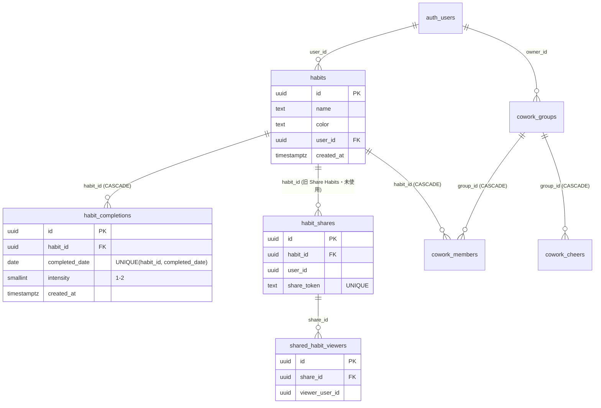

# Habitww 設計ドキュメント(アプリケーション内部)

毎日の習慣を記録し、GitHub 風の草グラフで可視化する習慣トラッカー。
外部連携(Supabase / Cloudflare / Google OAuth)は [integration.md](./integration.md) を参照。

## 技術スタック

| 領域 | 採用技術 |
|---|---|
| UI | React 19 + MUI v7 (@mui/material, @mui/icons-material, Emotion) |
| ビルド | Vite 8 (rolldown) + TypeScript 5.9 |
| BaaS | Supabase (@supabase/supabase-js v2) — DB / 認証 / Realtime |
| QR | qrcode.react(生成)、jsqr(カメラ読み取り) |
| フォント | @fontsource/roboto(セルフホスト) |

サーバーサイドコードは存在しない。純粋なクライアントサイド SPA で、ブラウザから
Supabase の Data API を直接呼ぶ構成。ルーターは使わず、`App.tsx` 内の
`useState<'habits' | 'stats' | 'achievements' | 'cowork'>` と MUI `BottomNavigation` で画面を切り替える
(URL はナビゲーションで変化しない)。

## ディレクトリ構成

```
habitww_ng/
├── index.html            # エントリ。React マウント前の静的スケルトン(shimmer)入り
├── wrangler.jsonc        # Cloudflare Workers 設定(integration.md 参照)
├── src/
│   ├── main.tsx          # ReactDOM ルート、Roboto フォント読み込み
│   ├── App.tsx           # 中核(~1,000行): 認証状態、習慣CRUD、画面ナビゲーション
│   ├── supabase.ts       # Supabase クライアント生成 + 型定義(Habit 等)
│   ├── theme.ts          # MUI テーマ
│   ├── LoginPage.tsx     # Google ログイン画面
│   ├── StatsPage.tsx     # 統計画面
│   ├── CoworkPage.tsx    # Cowork Habits: グループ一覧・招待 QR・承認・メニュー(Realtime 購読)
│   ├── CoworkGroupCard.tsx # グループ 1 つのカード(今日の状況・みんなで達成のグリッド)
│   ├── CoworkCreateDialog.tsx / CoworkJoinDialog.tsx / CoworkHabitPicker.tsx
│   ├── cowork.ts         # みんなで達成した日・連続の計算(純粋関数)
│   ├── QRScannerDialog.tsx # カメラで招待QRを読み取る(getUserMedia + jsqr)
│   ├── ActivityGrid.tsx  # 草グラフ
│   ├── AchievementDots.tsx
│   ├── SkeletonFallbacks.tsx # lazy load 中のフォールバック
│   └── vite-env.d.ts     # 環境変数の型定義
├── public/               # 静的アセット(アイコン、manifest.json)
├── supabase/migrations/  # DB スキーマ(下記)。適用方法は integration.md
└── docs/                 # 本ドキュメント
```

## 画面と機能

- **ログイン** (`LoginPage.tsx`): Google / X の OAuth(Apple は `enabled: false`)。未ログイン時に表示。
  画面全体のグラデーションと漂うぼかし円の上に、アプリアイコン(`public/app-icon-512.png` をそのまま。ベージュの余白まで含めてアイコン。加工しない)・「Habitww」・「小さな努力を大きな成長に」・ボタン。カードは無し
- **習慣** (`App.tsx` 内): 習慣の作成/編集/削除、当日タップで完了記録。
  タップを重ねると intensity(1=達成, 2=ばっちり達成)が切り替わる。
  記録操作時に `navigator.vibrate` で触覚フィードバック(対応端末のみ)
  - カードの ⋮ メニュー: 実施時間 / **カードの変更**(作成時と同じ `AddHabitDialog` を値入りで開き、
    名前・目標・カラーを変える。ボタンは「変更完了」)/ カードを裏返す / **アーカイブ** / 削除
  - **アーカイブ** (`habits.archived_at`、`20261019000000_add_habit_archived.sql`): 目的を達成した習慣を
    削除せずに記録画面から外す。`activeHabits`(archived_at なし)だけを一覧・N/M 完了・フィーバー・
    Cowork の習慣選択に使い、実績・統計・キャッシュには全部を渡す(取ったバッジは消えない)。
    最下部の小さなリンク「アーカイブした習慣 (N)」から一覧(`ArchivedHabitsDialog.tsx`)を開き、
    「戻す」「削除」ができる。全部達成(perfectDay)はアーカイブした日以降その習慣を無いものとして数え、
    月間メダルはアーカイブした日で判定を打ち切る(進行中にしない。年間棚もその月より後の枠を出さない)。
    iOS のウィジェット・通知は取得時に `archived_at=is.null` で除く
  - **削除は論理削除** (`habits.deleted_at`、`20261020000000_add_habit_deleted.sql`): 画面(記録・統計・
    アーカイブ一覧・メダルの行・実績のドット)からは外すが、記録は残して **バッジ・メダルの判定には使い続ける**
    (取った実績は消えない)。Cowork のグループ登録だけは本当に外す。アカウント削除はこれまでどおり物理削除。
    iOS は `deleted_at=is.null` でも絞る
- **達成演出** (`App.tsx` の `handleToggle` / `ConfettiBurst` / `FeverOverlay`):
  タップ即時(通信完了を待たない)に発火。達成=小さめ紙吹雪+バウンス+短い振動、
  ばっちり達成=紙吹雪フル+ボタンが虹グラデーションで常時発光、
  当日の全習慣が達成になった瞬間=全画面の紙吹雪の雨+虹色「ALL CLEAR!」バナー(約3.2秒)。
  上部の「n/n 完了」チップも全達成時は虹色になる
- **統計** (`StatsPage.tsx`): 草グラフ・達成率などの可視化。
  「実績バッジ」カード(`Badges.tsx`)は月間パーフェクトのメダル(月の1日〜末日を
  全日実施、年号刻印)・連続記録と自己ベスト・累計マイルストーンのトロフィー(SVG、
  常時の後光アニメーション)を表示
- **カードランク** (`habitStats.ts` の `RARITY_TIERS` / `cardFinish.ts`): 習慣の累計日数で
  カード裏面の素材が上がる。ノーマル → ブロンズ(8日) → シルバー(30日) → ゴールド(100日)
  → プラチナ(200日) → ホロ(365日)。ブロンズは磨いた青銅(刻印は明るい色)、ゴールドは
  彩度を抑えたシャンパンゴールド、プラチナは白地に細いヘアライン、ホロは虹が流れる。昇格時は
  `RankUpEffect.tsx` の全画面演出。実績ページの「カードランク」バッジは同じ素材のミニカード
- **メダルケース** (`AchievementBook.tsx` の `MedalCase`): 月間パーフェクトのメダルを
  習慣ごとに棚に並べる(金の縁・光が走る。月末から 7 日以内に取ったものは光って NEW)
- **授与式** (`AwardCeremony.tsx` / `awards.ts`): バッジ・メダルを新しく取ったときの全画面演出。
  `App.tsx` が記録が変わるたびに `evaluateAll` し、`habitww-awarded`(localStorage)との差分を
  溜めて、紙吹雪や昇格演出のあとに 1 つずつ出す。初回は今ある分を「見せた」扱いにする
- **メダルケース(年間棚)** (`AchievementBook.tsx` の `MedalCase`): 習慣ごとに 1〜12 月の 12 枠。
  取った月はメダル、今月は点線で「あと N日」、逃した月は数字だけ。年の切り替え。12/12 で
  「年間パーフェクト」。月末から 7 日以内のメダルは光って NEW
- **名前の横のバッジ(称号)** (`NameEmblem.tsx` / `SettingsDialog.tsx`): 取ったバッジから 1 つ選び
  `user_metadata.emblem` に保存。設定の名前の横と、Cowork のメンバー名の横(`cowork_members.emblem`
  に写す。`20261017000000_add_cowork_member_emblem.sql`)に小さく出す
- **バッジの道のり** (`AchievementBook.tsx` の `Detail`、`achievements.ts` の `seriesOf` / `nextStep`):
  同じ系列(3日→7日→21日…)の梯子と今の位置、「次は『…』まで あと N日」、「記録を始めて N日目に獲得」、
  取った習慣(連続・カードランク・月間パーフェクトは最初に達成した習慣を `state.habit` に入れる)
- **おもちゃ箱** (`ToyBox.tsx` / `toyPhysics.ts`): バッジ図鑑の見出しの「🪙 おもちゃ箱」から開く全画面の遊び。
  最初は取ったバッジと月間メダルが棚のように整然と並んでいて(`shelfLayout`。収まらなければ間隔を
  縮めて重ねる)、1 つ 1 つが棚に固定されている(`Body.pinned`)。指でなぞる(`sweep`)と、なぞった線に
  触れた物体だけ固定が外れて落ち、落ちた物体が最初に上からぶつけた相手 1 つも外れる(`knocks`。ドミノの
  ように触れた列だけが下まで崩れ、まわりは残る。横からの小突きや、乗っているだけでは外れない)。
  「ゆらす」は全部一度に崩す。固定された物体の上に落ちた物体はそのまま乗る。崩れたあとは指でつまんで
  はじけて、つまんだ物体を棚にぶつけると向きを問わず外せる。固定された物体から始めたなぞりは崩し、
  落ちている物体から始めたなぞりはつまみ。「並べ直す」で棚に戻る。ぶつかると `navigator.vibrate`。
  物理は自前の円の衝突(`toyPhysics.ts`、純粋関数。位置を先に直してから速度を位置の差で出す。棚に
  重ねて並べた相手とは、外れたときすり抜ける(`GHOST_OVERLAP`)ので飛び散らない)。
  端末の傾き・振りのセンサーは使わない(iOS の許可ダイアログを出さないため。重力は常に下)
  - **積み上げタワー**: 足場(`World.platform`)の上に 1 つずつ指で落として何個積めるか。足場の外
    (箱の底)に落ちたら 1.2 秒後に終了。自己ベストだけ端末に覚える(`habitww-toybox-tower-best`)
  - **画像でシェア** (`toyShare.tsx`): 箱の中の山をそのまま 1080×1350 の SVG に描き直し(HTML を含む
    画面のバッジは使えないので、全部 SVG 版を持つ)、canvas で PNG にして Web Share API で共有。
    共有シートが無い環境では画像を見せて保存してもらい、X の投稿画面を開く
- **Cowork Habits** (`CoworkPage.tsx` / `CoworkGroupCard.tsx` / `cowork.ts`):
  - 仲間とグループを作り、各メンバーが**自分の習慣を 1 つ**登録する(1 つの習慣を
    共同編集するのではない。記録は各自の habits / habit_completions のまま)
  - 作成者の招待リンク(`/?cowork=<invite_token>`)か QR から参加を申請。参加時に
    既存の習慣を紐づけるか、同名の習慣を新しく作るかを選ぶ
  - 加入は承認制。承認できる人は「作成者だけ」か「メンバー全員」(`cowork_groups.approval`)
  - カードは「今日で終わる 7 日間 × メンバー」の表(行がメンバー、列が日。やった日は本人の色の丸、
    今日の列を強調。下に「みんなで」の行: 全員達成の日は ★、そうでなければ 2/3 のような人数)と、
    今日のひとこと(自分がまだなら「あとはあなただけ！」、済んでいれば「あと N人」)。
    「これまで」を開くと、グループが始まった週からの「みんなで達成した日」のグリッド
    (承認済みメンバーが 2 人以上いて全員達成した日に ★)と各メンバーの草グラフ。
    記録画面には他人の情報を出さない
  - **応援(👏)**: 仲間の行(名前のブロック)をタップすると `cowork_cheers` に 1 行(1 人 → 1 人、
    1 日 1 回。もう一度で取り消し)。相手の名前の下に「okuura👏 みき👏 +2」(自分が送った分は強調)。
    今日の分だけ出す。Realtime で相手に届き、自分宛が増えたらスナックバーで「okuura さんから 👏」。
    テーブルが無ければ機能ごと隠す(`CoworkPage` の `cheers === null`)
  - 招待トークンは `App.tsx` 起動時に `URLSearchParams` で読み取り、RPC `cowork_preview`
    で下見してから `history.replaceState` で URL から除去する
  - 旧 Share Habits(`habit_shares` / `shared_habit_viewers`)は画面から外した。
    テーブルとポリシーは残っている

## データモデル

`supabase/migrations/` の SQL が正。2026-08 時点の最終形:



### RLS(Row Level Security)方針

- `habits` / `habit_completions`: 所有者(`habits.user_id = auth.uid()`)のみ
  読み書き可。completions は habit の所有を EXISTS で辿って判定
- Cowork: `cowork_groups` は承認済みメンバーと申請中の本人が読め、作成者だけが
  更新・削除できる。`cowork_members` への INSERT はポリシーを作らず RPC
  `cowork_join`(security definer、招待トークンを検証)経由のみ。同じグループの
  承認済みメンバーは、メンバーの habits(名前・色)と承認済みメンバーの
  completions を **SELECT のみ** 可能。承認は RPC `cowork_approve`
  (`is_cowork_approver` で判定)。ポリシー内の自己参照は security definer の
  `is_cowork_member` / `cowork_my_status` で再帰を避けている
- 旧共有: `shared_habit_viewers` に登録された閲覧者は対象 habit と
  completions を **SELECT のみ** 可能(画面からは外したがポリシーは残る)
- 履歴上の注意: `20260705035317` が completions の UPDATE を全開放して
  いたが、`20260830000000_fix_completion_update_policy.sql` で所有者限定に修正済み

## 実装上の特記事項

- **コード分割**: `vite.config.ts` の `rolldownOptions` で vendor-react /
  vendor-mui / vendor-supabase をチャンク分離。画面コンポーネントは lazy import
- **初期表示**: `index.html` に CSS のみのスケルトン UI を直書きし、
  JS ロード前から画面骨格を見せる(ダークモードは `prefers-color-scheme` 対応)
- **セッション**: supabase-js のデフォルト(localStorage 保存、自動リフレッシュ)
- **PWA**: `public/manifest.json` で standalone 表示・ホーム追加に対応。
  Service Worker は未実装(オフライン非対応)
- **Realtime**: `CoworkPage.tsx` が `habit_completions` / `cowork_members` /
  `cowork_groups` の postgres_changes を購読(チャンネル名 `cowork-realtime`)
